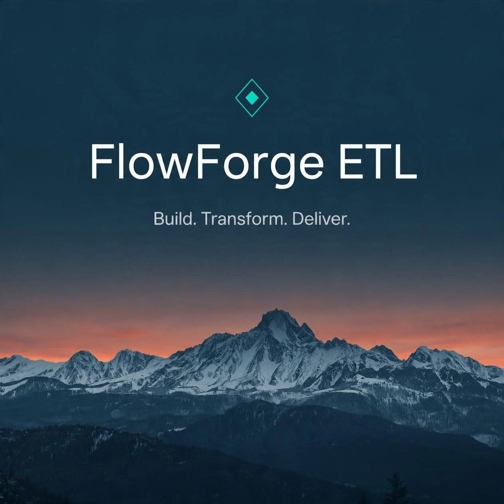

# FlowForge ETL

<p align="center">
  
</p>

<p align="center">
  <strong>A modular ETL application built with Java 21</strong><br />
  Extract · Transform · Load
</p>

<p align="center">
  
  
  
  
</p>

## What is FlowForge ETL?

FlowForge ETL is a modular Java application that automates a data-processing workflow: it reads CSV files, validates records, separates accepted and rejected data, stores results in SQL Server, and delivers generated output files.

## The problem it addresses

Moving data between files, databases, and external systems can involve repetitive manual steps and make failures difficult to track or recover from.

FlowForge brings these steps into one pipeline. It keeps processing stages separate, records execution and delivery state, and allows pending file deliveries to be retried without running the entire ingestion process again.

## How it works

1. **Extract** — reads incoming CSV files.
2. **Validate** — checks records and separates accepted and rejected data.
3. **Load** — persists the processed data and execution information in SQL Server.
4. **Deliver** — generates output CSV files and transfers them through SFTP.
5. **Track & recover** — records delivery status and supports retrying pending deliveries.

## Main features

- Modular pipeline engine with shared execution context.
- CSV extraction, validation, and serialization.
- SQL Server persistence and execution tracking.
- Accepted/rejected record handling.
- Output delivery tracking and recovery.
- SFTP transfers with SSH host-key verification.
- Automated unit tests and optional integration tests.

## Architecture

The project is organized as a Maven multi-module application:

| Module | Responsibility |
| --- | --- |
| `flowforge-core` | Pipeline model, execution engine, shared context, and generic abstractions |
| `flowforge-connectors` | CSV, SQL Server, and SFTP connectors |
| `flowforge-cash` | Cash-specific validation, persistence, pipeline composition, delivery, and CLI |

This separation keeps the pipeline engine and reusable connectors independent from the business workflow.

## Tech stack

**Java 21** · **Maven** · **SQL Server** · **JUnit 5** · **Mockito** · **SFTP / SSH**

## Run locally

**Prerequisites:** JDK 21, Apache Maven, and Git. SQL Server is needed to run the Cash database workflow.

```bash
git clone https://github.com/Alexis-miranda/flowforge-etl.git
cd flowforge-etl
mvn -pl flowforge-cash -am test
```

Build and verify all modules:

```bash
mvn clean verify
```

See the [end-to-end test report](docs/ETL-E2E-TEST-2026-10-25.md) for the recorded test results. Integration tests may require additional services and configuration.

## Project status

**In development.** The core pipeline, CSV processing, Cash validation, SQL Server persistence, delivery tracking/recovery, and SFTP transfer support are implemented.

The workflow is a personal development project and is not production-certified. Production use would require confirming the official file specification, mappings, operational monitoring, database permissions, and deployment security.

## Roadmap

- [ ] Confirm official output-file specification and production mappings.
- [ ] Add further transformation types.
- [ ] Explore message-broker integrations (RabbitMQ / IBM MQ).
- [ ] Evaluate a Spring Boot interface and service deployment.

---

<p align="center">
  <sub>Built with Java ☕</sub>
</p>
