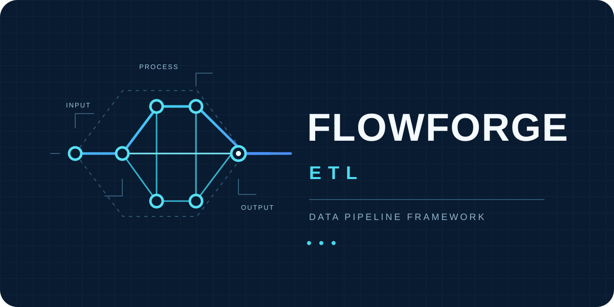

# FlowForge ETL

<p align="center">
  
</p>

<p align="center">
  <strong>A modular ETL application built with Java 21</strong><br />
  Extract · Transform · Load
</p>

<p align="center">
  
  
  
  
</p>

## What is FlowForge ETL?

FlowForge ETL is a modular Java application that processes CSV data through configurable pipeline steps. Its first business workflow, Cash ETL, validates incoming records, stores accepted and rejected data in SQL Server, and generates a local FRONT output CSV.

## The problem it addresses

Moving data between files and databases often involves repetitive manual steps and makes failures difficult to track or recover from.

FlowForge brings the ingestion, validation, persistence, and output preparation stages into one pipeline. It records execution and delivery state, prevents duplicate loads for the same source identifier, and supports recovery of pending output deliveries.

## Cash workflow

1. **Extract** — reads an input CSV containing `accountCode`, `adjustmentId`, `currency`, and `amount`.
2. **Validate** — separates accepted and rejected records and records rejection reasons.
3. **Persist** — stores accepted records, rejected records, original-row audit data, and a pending output delivery in SQL Server.
4. **Prepare and publish** — creates a FRONT CSV containing accepted records and publishes it to the configured local output directory.
5. **Track and recover** — records delivery status and allows pending local deliveries to be retried without reloading the source data.

The current Cash workflow publishes to the local filesystem. The reusable SFTP connector is implemented separately and is not yet wired into this Cash workflow.

## Main features

- Modular pipeline engine with shared execution context.
- CSV extraction, validation, and serialization.
- SQL Server persistence with transactional load control.
- Accepted/rejected record handling and original-row audit.
- Pipeline and step execution history.
- Local output delivery tracking, integrity verification, and recovery.
- Reusable SFTP connector with SSH host-key verification.
- Automated unit and filesystem-based integration tests.
- Optional SQL Server integration tests.

## Architecture

The project is organized as a Maven multi-module application:

| Module | Responsibility |
| --- | --- |
| `flowforge-core` | Pipeline model, execution engine, shared context, and generic abstractions |
| `flowforge-connectors` | CSV, SQL Server, and SFTP connectors |
| `flowforge-cash` | Cash-specific validation, persistence, pipeline composition, delivery, and CLI |

This separation keeps the pipeline engine and reusable connectors independent from the business workflow.

## Tech stack

**Java 21** · **Maven** · **SQL Server** · **JUnit 5** · **Mockito** · **SFTP / SSH**

## Build and test

**Prerequisites:** JDK 21 and Apache Maven.

Run the complete build and test suite:

```bash
mvn --batch-mode clean verify
```

The GitHub Actions workflow runs this same command on pushes to `main` and `feature/**` branches, and on pull requests targeting `main`.

The filesystem-based Cash pipeline integration test runs without external services. The SQL Server integration tests are skipped unless all three environment variables are configured:

- `FLOWFORGE_DB_JDBC_URL`
- `FLOWFORGE_DB_USER`
- `FLOWFORGE_DB_PASSWORD`

Do not commit real credentials. Configure these variables in your local environment before running the SQL Server integration tests.

## SQL Server setup

The Cash workflow expects a SQL Server database named `FlowForgeETL_Dev`. Create the database, then execute the scripts in `docs/cash/sql` in this order:

1. `01-cash-staging-schema.sql`
2. `03-cash-rejected-schema.sql`
3. `04-cash-master-audit-schema.sql`
4. `05-cash-load-control-schema.sql`
5. `06-cash-output-delivery-schema.sql`

The optional reconciliation tables in `02-cash-reconciliation-schema.sql` are not required by the first Cash workflow.

See [SQL setup instructions](docs/cash/sql/README.md) and the [historical end-to-end test report](docs/ETL-E2E-TEST-2026-10-25.md).

## Run the Cash CLI

The CLI entry point is `com.flowforge.etl.cash.cli.CashPipelineCli`. It accepts:

```text
<input.csv> <backOfficeCode> <outputDir> [columns] [sourceFile]
```

Example:

```text
cash-input.csv BNYM ./output accountCode,currency,amount cash-delivery-2026-11-21.csv
```

Provide a unique `sourceFile` identifier for each distinct input batch. Reusing the same identifier is intentionally treated as a duplicate load. The SQL Server connection variables above must be configured before running the Cash pipeline.

The recovery entry point is `com.flowforge.etl.cash.cli.CashOutputRecoveryCli`. It retries pending local output deliveries from SQL Server.

## Project status

**First functional release candidate — Cash workflow.** The core pipeline, CSV processing, Cash validation, SQL Server persistence, audit history, local output publication, and delivery recovery are implemented.

This is a personal development project, not a production-certified system. Before production use, the official input/output specification, business mappings, operational monitoring, database permissions, backup strategy, and deployment security must be reviewed.

## Roadmap

- [ ] Confirm the official output-file specification and production mappings.
- [ ] Add further transformation types.
- [ ] Explore message-broker integrations (RabbitMQ / IBM MQ).
- [ ] Evaluate a Spring Boot REST interface and service deployment.
- [ ] Integrate SFTP delivery into the Cash workflow.

---

<p align="center">
  <sub>Built with Java ☕</sub>
</p>
