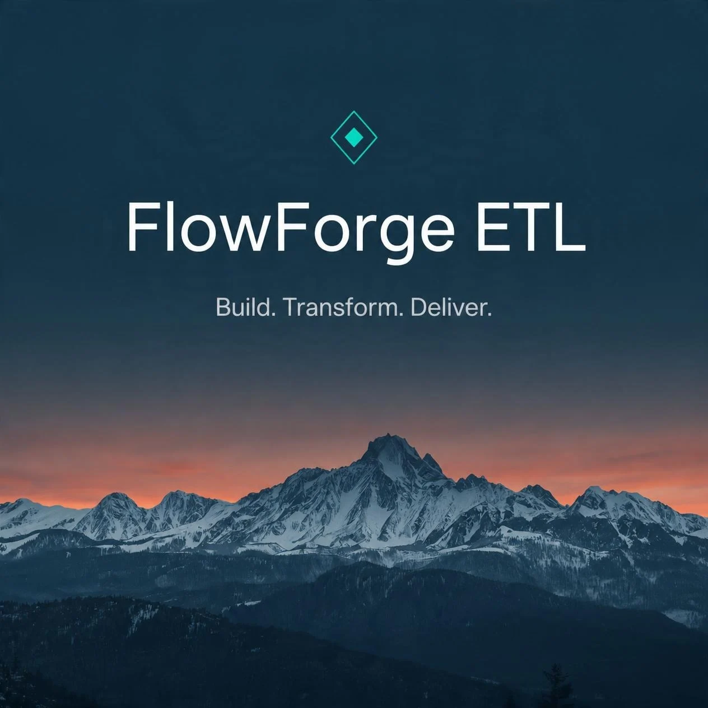
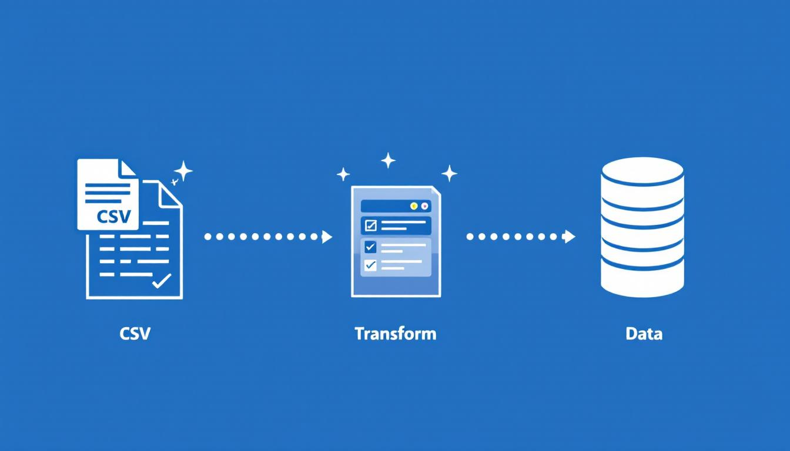


# FlowForge ETL

<p align="center">
  
</p>

<p align="center">
  <strong>A modular ETL platform built with Java 21</strong>
  <br />
  Extract · Transform · Load
</p>

<p align="center">
  
  
  
  
</p>

---

## About

**FlowForge ETL** is a modular and extensible platform for building and executing data pipelines.

The project provides a foundation for extracting, transforming, and loading data through configurable workflows, with a focus on clean architecture, testability, and maintainability.

## Features

- **CSV Extraction** — read structured data from CSV files.
- **Data Transformation** — transform selected column values to uppercase.
- **CSV Loading** — write processed records to CSV files.
- **Pipeline Execution** — execute pipeline steps sequentially in the defined order.
- **Shared Execution Context** — pass data between pipeline steps.
- **Execution Tracking** — track execution status, duration, and failure details.
- **Automated Testing** — verify components with unit and integration tests.
- **Modular Architecture** — keep domain, execution, extraction, transformation, and loading responsibilities separate.

## Architecture

FlowForge ETL currently consists of the `flowforge-core` Maven module.

| Package | Responsibility |
| --- | --- |
| `domain` | Pipeline definitions, steps, configurations, and statuses |
| `execution` | Pipeline execution, context, results, and listeners |
| `extract` | CSV data extraction |
| `transform` | Data transformation |
| `load` | CSV output |

### ETL Workflow

<p align="center">
  
</p>

The current workflow demonstrates how data moves through the pipeline:

1. **Extract** — read records from an input CSV file.
2. **Transform** — convert the selected column values to uppercase.
3. **Load** — write the processed records to an output CSV file.

## Technology Stack

| Technology | Purpose |
| --- | --- |
| Java 21 | Programming language |
| Apache Maven | Build and dependency management |
| Apache Commons CSV | CSV parsing and writing |
| JUnit Jupiter 5 | Automated testing |

### Planned Technologies

- Spring Boot with embedded Apache Tomcat.
- Microsoft SQL Server connectivity through JDBC.
- RabbitMQ for asynchronous messaging.
- Windows Server 2025 deployment as a Windows service.
- Additional data sources, transformations, and loaders.

*The technologies listed above are planned integrations and are not yet implemented.*

## Getting Started

### Prerequisites

- JDK 21
- Apache Maven

Verify your environment:

```bash
java -version
mvn -version
```

### Clone the Repository

```bash
git clone https://github.com/Alexis-miranda/flowforge-etl.git
cd flowforge-etl
```

### Validate the Project

```bash
mvn validate
```

### Build and Run Tests

```bash
mvn clean verify
```

This command compiles the project and runs the automated test suite.

## Project Status

**Under active development**

The current implementation supports CSV extraction, uppercase transformation, CSV loading, sequential pipeline execution, execution status tracking, and integration testing.

## Roadmap

- [x] Core pipeline execution
- [x] CSV extraction
- [x] Uppercase transformation
- [x] CSV loading
- [x] Unit and integration tests
- [ ] Microsoft SQL Server integration
- [ ] RabbitMQ messaging
- [ ] Spring Boot web interface
- [ ] Windows service deployment
- [ ] Additional transformation types

## License

No license has been selected yet.

---

<p align="center">
  <sub>Built with Java ☕ and a focus on clean, modular ETL architecture.</sub>
</p>

No license has been selected yet.

---

<p align="center">
  <sub>Built with Java ☕ and a focus on clean, modular ETL architecture.</sub>
</p>