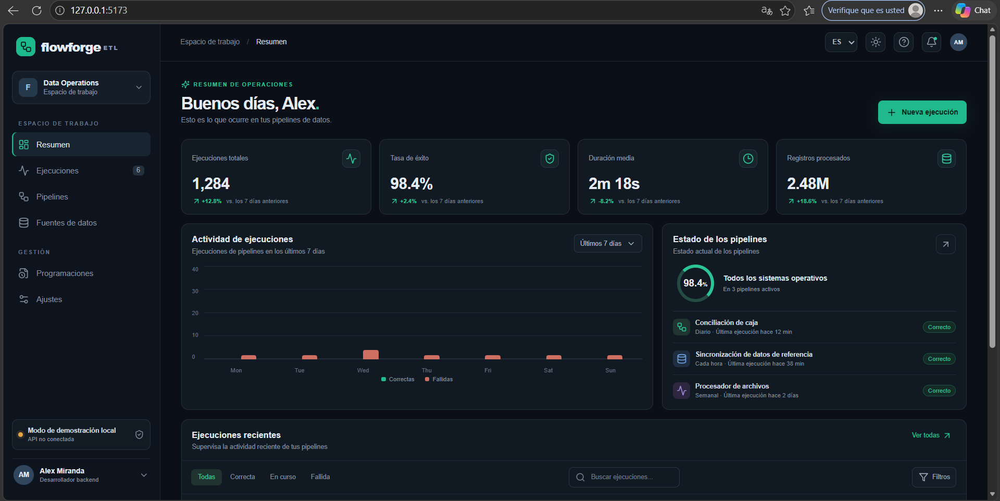

# FlowForge ETL

A modular ETL application built with **Java 21**. FlowForge processes CSV data through ordered pipeline steps; its first workflow, Cash ETL, validates records, persists accepted/rejected data in SQL Server, and publishes a FRONT CSV artifact.

<p align="center">
  
</p>

<p align="center">
  
</p>

<p align="center">
  
  
  
  
</p>

## What it does

- Runs configurable, ordered ETL pipeline steps.
- Validates Cash CSV records and separates accepted and rejected rows.
- Persists execution history and business data in SQL Server.
- Publishes local output artifacts and supports recovery of pending deliveries.
- Uses RabbitMQ and an SQL Server outbox for asynchronous execution requests.
- Exposes a REST API for submitting requests and querying execution history.

## Architecture

The Maven project is split into five modules:

| Module | Responsibility |
| --- | --- |
| `flowforge-core` | Generic pipeline engine and domain model. |
| `flowforge-connectors` | CSV, SQL Server, and SFTP connectors. |
| `flowforge-cash` | Cash workflow, persistence, output delivery, and worker. |
| `flowforge-messaging` | RabbitMQ messaging, request handling, and outbox abstractions. |
| `flowforge-api` | HTTP API. |

See [the architecture guide](docs/architecture.md) for the execution flow and module details.

## Quick start

**Requirements:** JDK 21 and Maven. SQL Server and RabbitMQ are needed for the full asynchronous workflow. Node.js 20+ and npm are needed for the dashboard.

Run backend verification:

```bash
mvn --batch-mode clean verify
```

Run the dashboard:

```bash
cd frontend
npm install
npm run dev
```

On Windows PowerShell, if `npm.ps1` is blocked by execution policy, use `npm.cmd install` and `npm.cmd run dev -- --host 127.0.0.1`.

For database configuration, schema setup, CLI, worker, and API startup instructions, see the [local development guide](docs/development/local-setup.md).

## Dashboard status

The React dashboard is a prototype. Its metrics, charts, execution rows, and details use illustrative frontend data. The Cash form adds a local demo row only; it does not call the REST API yet.

## API

The development API supports submitting Cash executions and querying recent executions, execution status, and step history. See the [API reference](docs/api-reference.md).

**Security boundary:** the API has no authentication, authorization, TLS termination, rate limiting, or CORS policy and binds to loopback by default. Do not expose it to an untrusted network. Requests carry a filesystem path, not an uploaded file.

## Project status

<badge>Demo candidate · active development</badge>

Cash output currently targets the local filesystem. SFTP publication is not integrated into the Cash workflow. This project is not production-ready; review the [roadmap and release boundaries](docs/roadmap.md) before planning a public demo or real-data deployment.

## Documentation

- [Architecture](docs/architecture.md)
- [Local development setup](docs/development/local-setup.md)
- [REST API reference](docs/api-reference.md)
- [Cash SQL schema setup](docs/cash/sql/README.md)
- [Roadmap and release boundaries](docs/roadmap.md)

