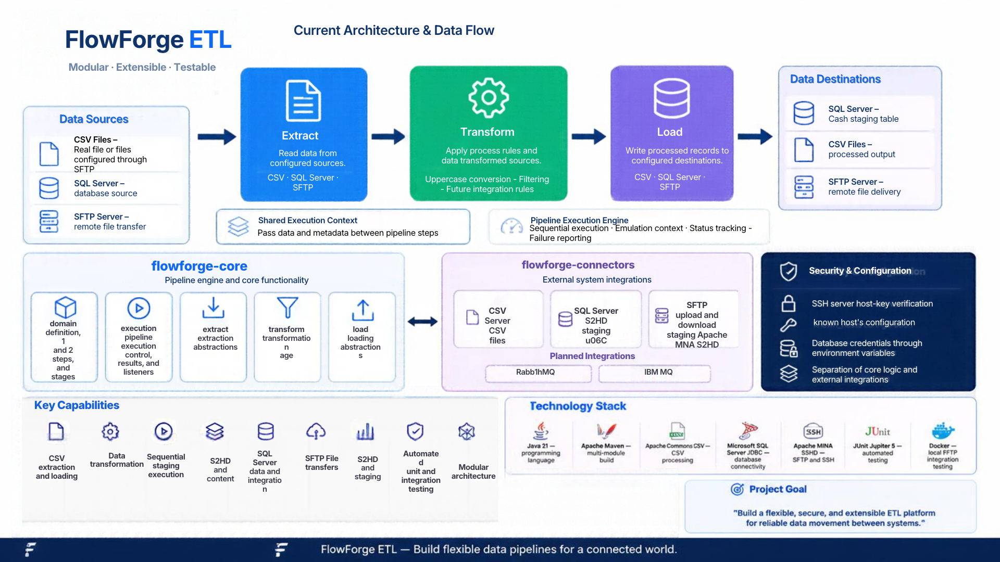

# FlowForge ETL

<p align="center">
  
</p>

<p align="center">
  <strong>A modular ETL platform built with Java 21</strong>
  <br />
  Extract · Transform · Load
</p>

<p align="center">
  
  
  
  
</p>

---

## About

**FlowForge ETL** is a modular and extensible platform for building and executing Extract, Transform, Load (ETL) pipelines.

Built with Java 21 and Apache Maven, the project separates its core pipeline execution engine from its external connectors. This architecture is designed to support maintainable workflows, independently developed integrations, and automated testing.

The current implementation includes CSV processing, sequential pipeline execution, SQL Server staging support, and secure SFTP file transfers.

## Features

- **CSV Extraction** — read structured records from CSV files.
- **Data Transformation** — transform selected column values to uppercase.
- **CSV Loading** — write processed records to CSV files.
- **Pipeline Execution** — execute configured pipeline steps sequentially.
- **Shared Execution Context** — transfer data between pipeline steps.
- **Execution Tracking** — capture execution status, duration, and failure details.
- **SQL Server Integration** — load cash-related records into a SQL Server staging table.
- **SFTP File Transfers** — upload and download files using SSH File Transfer Protocol.
- **SSH Host Verification** — verify SFTP server host keys against a known-hosts file.
- **Automated Testing** — validate components with unit tests and opt-in integration tests.
- **Modular Architecture** — separate core execution logic from external system integrations.

## Architecture

FlowForge ETL is organized as a Maven multi-module project.

| Module | Responsibility |
| --- | --- |
| `flowforge-core` | Pipeline domain model, execution engine, shared context, transformations, and execution results |
| `flowforge-connectors` | CSV, SQL Server, and SFTP integrations, along with connector registration and pipeline executor wiring |

### Core module

The `flowforge-core` module contains the engine-independent building blocks used to define and execute pipelines.

| Component | Responsibility |
| --- | --- |
| `domain` | Pipeline definitions, steps, configurations, and execution statuses |
| `execution` | Pipeline execution, shared context, results, and listeners |
| `extract` | Core extraction abstractions and related functionality |
| `transform` | Data transformation logic |
| `load` | Core loading abstractions and related functionality |

### Connectors module

The `flowforge-connectors` module provides integrations with external systems.

| Connector | Current capability |
| --- | --- |
| CSV | Read and write CSV files |
| SQL Server | Load records into the `dbo.CashStaging` table |
| SFTP | Upload and download files with SSH host-key verification |
| RabbitMQ | Planned; connector implementation pending |
| IBM MQ | Planned; connector implementation pending |

### ETL Workflow

<p align="center">
  
</p>

A basic pipeline follows these steps:

1. **Extract** — read records from an input source.
2. **Transform** — apply the configured transformation logic.
3. **Load** — write the resulting records to a destination.

The core engine executes steps in sequence and uses a shared execution context to pass data between them. Connectors provide the integration-specific operations.

The SQL Server cash staging connector is implemented, but the complete Cash ETL workflow still requires end-to-end validation.

## Technology Stack

| Technology | Purpose |
| --- | --- |
| Java 21 | Application development |
| Apache Maven | Multi-module build and dependency management |
| Apache Commons CSV | CSV parsing and writing |
| Microsoft SQL Server JDBC Driver | Database connectivity |
| Apache MINA SSHD | SSH and SFTP client functionality |
| JUnit Jupiter 5 | Automated testing |
| Docker | Local SFTP integration testing |

## Getting Started

### Prerequisites

- JDK 21
- Apache Maven
- Git

Additional requirements depend on the integration being tested:

- Microsoft SQL Server and valid database credentials for database integration.
- Docker Desktop for the local SFTP integration test.

Verify your environment:

```bash
java -version
mvn -version
git --version
```

### Clone the Repository

```bash
git clone https://github.com/Alexis-miranda/flowforge-etl.git
cd flowforge-etl
```

### Validate, Build, and Test

Validate the Maven project:

```bash
mvn validate
```

Build all modules and run the test suite:

```bash
mvn clean verify
```

To run tests for the connectors module and its required modules:

```bash
mvn -pl flowforge-connectors -am test
```

Some integration tests are conditional and may be skipped unless their required environment and services are configured.

## Configuration

### SQL Server

The SQL Server cash staging loader reads credentials from environment variables:

- `FLOWFORGE_DB_USER`
- `FLOWFORGE_DB_PASSWORD`

Configure these variables in your local development environment before running database operations. Never commit actual credentials to the repository.

The current loader targets the `FlowForgeETL_Dev` database and the `dbo.CashStaging` table on the configured local SQL Server instance. Review the connector configuration if your SQL Server instance or database differs.

The staging table must contain the columns expected by the loader:

- `AccountCode`
- `AdjustmentId`
- `Currency`
- `Amount`
- `SourceFile`

Confirm the actual schema and data types in your database before running a load.

### SFTP

The SFTP connector uses Apache MINA SSHD to transfer files.

Server host keys are verified against the user's SSH `known_hosts` file. Host-key verification should remain enabled; do not disable it to work around connection errors.

A local SFTP test server can be started with Docker using the Compose configuration maintained for development. The integration test expects a server accessible at `localhost:2222`.

Use test-only credentials for local development and never expose production credentials in source code or documentation.

## Testing

The project includes unit tests for connector behavior and integration tests for external-system interactions.

### Run the standard test suite

```bash
mvn -pl flowforge-connectors -am test
```

### Run the SFTP integration test

Start the local SFTP test server and ensure its host key is present in your user's `known_hosts` file.

In PowerShell, enable the integration test for the current session:

```powershell
$env:FLOWFORGE_SFTP_INTEGRATION = "true"
mvn -pl flowforge-connectors -am -Dtest=SftpIntegrationTest -Dsurefire.failIfNoSpecifiedTests=false test
```

Remove the environment variable when finished:

```powershell
Remove-Item Env:FLOWFORGE_SFTP_INTEGRATION -ErrorAction SilentlyContinue
```

The integration test transfers a file to the SFTP server, downloads it, and verifies that the file contents match.

## Project Structure

```text
flowforge-etl/
├── pom.xml
├── flowforge-core/
│   └── src/
│       ├── main/java/
│       └── test/java/
├── flowforge-connectors/
│   ├── pom.xml
│   └── src/
│       ├── main/java/com/flowforge/etl/connectors/
│       │   ├── file/csv/
│       │   ├── database/sqlserver/
│       │   ├── integration/
│       │   └── sftp/
│       └── test/java/
└── docs/
    └── images/
```

This is a simplified view of the repository structure; individual packages may contain additional classes and tests.

## Project Status

**Under active development**

The core execution engine and several connectors are implemented. Automated tests cover core and connector behavior, and the SFTP integration test can be enabled against a local test server.

The complete Cash ETL workflow, including source-file ingestion, staging validation, and end-to-end execution, remains to be verified.

## Roadmap

- [x] Core pipeline execution
- [x] Shared execution context
- [x] CSV extraction and loading
- [x] Uppercase transformation
- [x] Execution status tracking
- [x] Maven multi-module architecture
- [x] SQL Server cash staging loader implementation
- [x] SFTP file transfer support
- [x] SSH host-key verification
- [x] SFTP integration test
- [ ] End-to-end Cash ETL validation
- [ ] Additional transformation types
- [ ] RabbitMQ integration
- [ ] IBM MQ integration
- [ ] Spring Boot web interface
- [ ] Windows service deployment

## License

No license has been selected yet. Until a license is added to the repository, permissions for reuse and redistribution are not explicitly granted.

---

<p align="center">
  <sub>Built with Java ☕ and a focus on clean, modular ETL architecture.</sub>
</p>