# SQL Server database schema

This document describes the SQL Server structures defined by the checked-in schema scripts for the `FlowForgeETL_Dev` development database. It is source-controlled documentation, not a claim that a live database instance has been inspected.

> **Schema source of truth:** the SQL scripts under [`docs/cash/sql/`](cash/sql/README.md) and [`docs/sql/`](sql/). If a local or deployed database differs from these scripts, inspect and reconcile the actual database before applying migrations or publishing the diagram as a live schema.

## Database areas

FlowForge stores two distinct categories of information:

1. **Execution infrastructure** — accepted API requests, outbox delivery state, pipeline execution audit, per-step audit, and worker leases.
2. **Cash workflow data** — accepted staging rows, rejected rows, a master row-level audit, file load control, and output-delivery artifacts.

The optional reconciliation schema adds expected transactions and reconciliation results. It is not required by the first Cash ETL workflow.

## Entity relationship diagram

The diagram reflects declared foreign keys in the checked-in DDL. Cash tables share `SourceFile` as a logical correlation key, but the current scripts do not declare foreign-key constraints between those tables. The execution lease is deliberately independent of the execution audit row so a lease can be acquired before an execution snapshot is inserted.

The source diagram is [`docs/diagrams/05-database-schema.mmd`](diagrams/05-database-schema.mmd).

```mermaid
erDiagram
    ETLExecution ||--o{ ETLStepExecution : "has step audit"
    ETLPipelineExecutionRequest ||--o| ETLOutboxMessage : "creates outbox message"
    CashStaging ||--o{ CashReconciliationResults : "optional reconciliation"
    CashExpectedTransactions ||--o{ CashReconciliationResults : "optional match"

    ETLExecution {
        varchar ExecutionId PK
        nvarchar PipelineId
        varchar Status
        nvarchar FailedStepId
        datetime2 StartedAt
        datetime2 FinishedAt
    }
    ETLStepExecution {
        varchar ExecutionId PK, FK
        nvarchar StepId PK
        nvarchar StepName
        varchar Status
        datetime2 StartedAt
        datetime2 FinishedAt
    }
    ETLPipelineExecutionRequest {
        nvarchar ExecutionId PK
        nvarchar PipelineType
        datetime2 RequestedAt
        varbinary Payload
    }
    ETLOutboxMessage {
        nvarchar MessageId PK
        nvarchar ExecutionId FK, UK
        varchar Status
        datetime2 CreatedAt
        datetime2 PublishedAt
    }
    ETLExecutionLease {
        varchar ExecutionId PK
        nvarchar OwnerId
        datetime2 LeaseUntil
        bigint FencingToken
    }
    CashStaging {
        bigint Id PK
        nvarchar AccountCode
        nvarchar AdjustmentId
        nvarchar Currency
        decimal Amount
        nvarchar SourceFile
        datetime2 ReceivedAt
        nvarchar ProcessingStatus
    }
    CashRejected {
        bigint Id PK
        nvarchar AccountCode
        nvarchar AdjustmentId
        nvarchar Currency
        nvarchar Amount
        nvarchar SourceFile
        nvarchar RejectionReason
        datetime2 RejectedAt
    }
    T_MASTER_CASH {
        bigint Id PK
        nvarchar SourceFile
        nvarchar BackOfficeCode
        bigint SourceRowNumber
        decimal Amount
        nvarchar ProcessingStatus
        nvarchar RejectionReason
        datetime2 CreatedAt
    }
    CashLoadControl {
        nvarchar SourceFile PK
        datetime2 LoadedAt
    }
    CashOutputDelivery {
        nvarchar SourceFile PK
        nvarchar BackOfficeCode
        nvarchar OutputFileName
        nvarchar OutputDirectory
        varbinary CsvPayload
        char PayloadSha256
        nvarchar DeliveryStatus
        nvarchar PublishedPath
        char PublishedSha256
        nvarchar PublishedExecutionId
        datetime2 CreatedAt
        datetime2 PublishedAt
    }
    CashExpectedTransactions {
        bigint Id PK
        nvarchar AdjustmentId
        nvarchar AccountCode
        nvarchar Currency
        decimal ExpectedAmount
        datetime2 CreatedAt
    }
    CashReconciliationResults {
        bigint Id PK
        bigint StagingId FK
        bigint ExpectedTransactionId FK
        nvarchar ReconciliationStatus
        decimal DifferenceAmount
        nvarchar Details
        datetime2 ReconciledAt
    }
```



### Relationship notes

| Relationship | Constraint / meaning |
| --- | --- |
| `ETLExecution` → `ETLStepExecution` | Declared foreign key on `ExecutionId`; one execution can have multiple step-audit rows. |
| `ETLPipelineExecutionRequest` → `ETLOutboxMessage` | Declared foreign key on `ExecutionId`; a unique constraint on the outbox execution ID allows at most one outbox message per request. |
| `ETLExecutionLease` | Intentionally has no foreign key to `ETLExecution`; lease acquisition precedes insertion of the execution snapshot. |
| Cash tables | `SourceFile` is a logical correlation key across load-control, staging, rejected, master-audit, and delivery records. The current DDL does not declare foreign keys among these tables. |
| Reconciliation tables | Optional schema; declared foreign keys link results to staging rows and expected transactions. |

## Table inventory

### Execution infrastructure

- `dbo.ETLPipelineExecutionRequest`: durable request payload accepted by the API.
- `dbo.ETLOutboxMessage`: pending/published state, publish attempts, and last publishing error for each accepted request.
- `dbo.ETLExecution`: pipeline-level execution status, timing, and failure details.
- `dbo.ETLStepExecution`: persisted status and failure information for individual pipeline steps.
- `dbo.ETLExecutionLease`: worker ownership, lease expiry, and fencing token.

### Cash business data

- `dbo.CashStaging`: accepted records, with `Amount` stored as `DECIMAL(19,4)`.
- `dbo.CashRejected`: rejected records; `Amount` remains text so invalid source values can be preserved.
- `dbo.T_MASTER_CASH`: row-level audit of accepted and rejected records, including source row number and raw record.
- `dbo.CashLoadControl`: one load-control record per `SourceFile`; its primary key prevents reloading the same source-file identifier.
- `dbo.CashOutputDelivery`: output payload, checksum, delivery status, and published artifact metadata.

### Optional reconciliation

- `dbo.CashExpectedTransactions`: expected transaction data used by the optional reconciliation workflow.
- `dbo.CashReconciliationResults`: reconciliation outcome and optional link to the matched expected transaction.

## Example read-only queries

### Recent pipeline executions and their step audit

```sql
SELECT
    e.ExecutionId,
    e.PipelineId,
    e.Status AS ExecutionStatus,
    e.StartedAt,
    s.StepId,
    s.StepName,
    s.Status AS StepStatus,
    s.StartedAt AS StepStartedAt,
    s.FinishedAt AS StepFinishedAt
FROM dbo.ETLExecution AS e
LEFT JOIN dbo.ETLStepExecution AS s
    ON s.ExecutionId = e.ExecutionId
ORDER BY e.StartedAt DESC, s.StartedAt;
```

### Outbox dispatch status

```sql
SELECT
    r.ExecutionId,
    r.PipelineType,
    r.RequestedAt,
    o.Status AS OutboxStatus,
    o.PublishAttempts,
    o.PublishedAt,
    o.LastError
FROM dbo.ETLPipelineExecutionRequest AS r
INNER JOIN dbo.ETLOutboxMessage AS o
    ON o.ExecutionId = r.ExecutionId
ORDER BY r.RequestedAt DESC;
```

### Accepted and rejected record counts by source file

```sql
SELECT
    SourceFile,
    ProcessingStatus,
    COUNT(*) AS RecordCount
FROM dbo.T_MASTER_CASH
GROUP BY SourceFile, ProcessingStatus
ORDER BY SourceFile, ProcessingStatus;
```

These queries are read-only examples. Run them against a development database and confirm that the target instance has been initialized with the corresponding schema scripts.

## Setup

Follow the ordered installation instructions in [Cash SQL Server setup](cash/sql/README.md). Do not run schema scripts against a database containing important data without reviewing the current table definitions and taking an appropriate backup.
